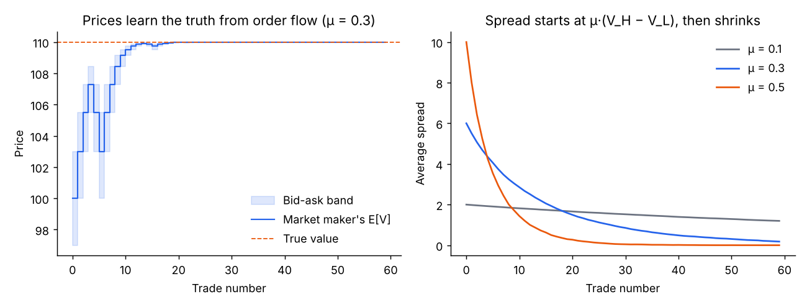
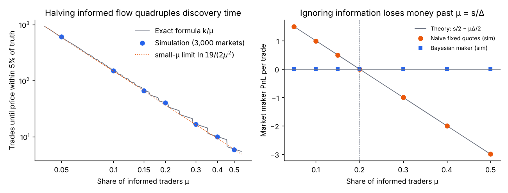
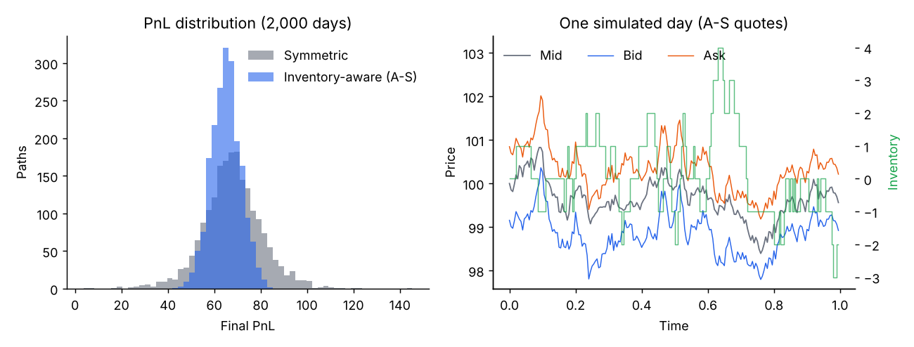
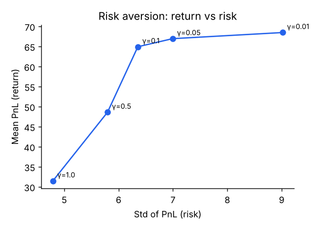
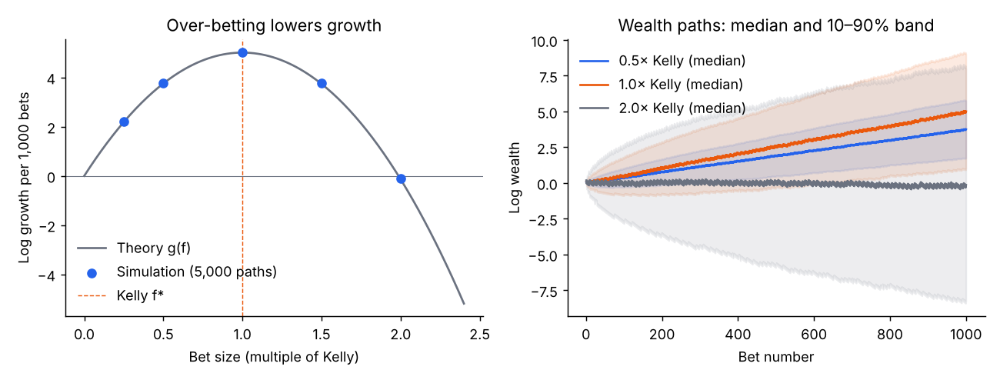
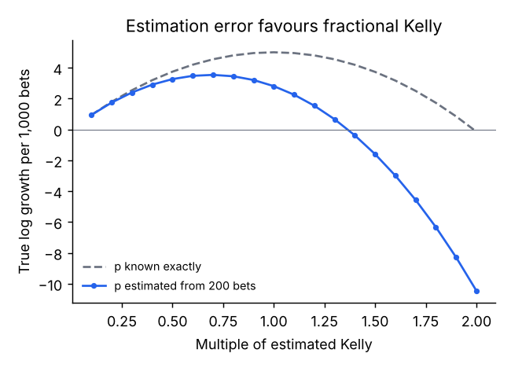
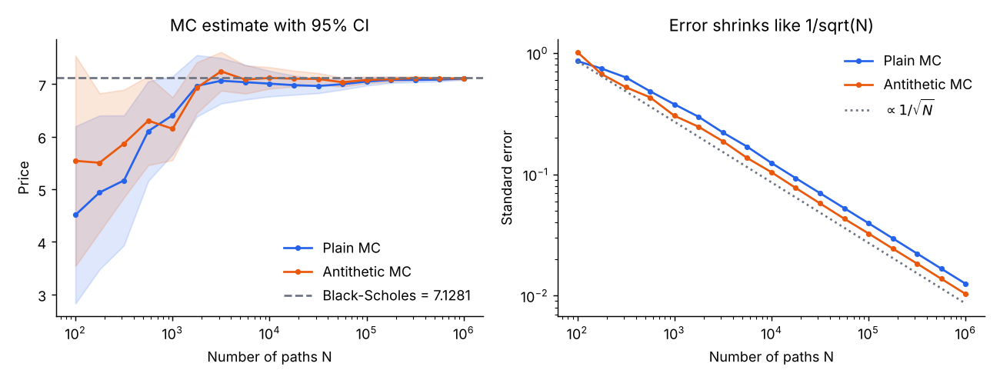

# quant-sim

Four small, readable studies of problems at the centre of quantitative trading. Each one is simulated, and each headline number is checked against a closed-form result.

| Study | Question | Key result |
|---|---|---|
| **Adverse selection** (Glosten–Milgrom 1985) | Why does a market maker quote a spread, and how fast do prices learn? | Exact discovery time k/μ; simulation 16.71 ± 0.23 vs exact 16.67 trades |
| **Inventory risk** (Avellaneda–Stoikov 2008) | How should quotes react to the position you carry? | 4% lower mean PnL, half the PnL volatility, ~2× return per unit risk |
| **Bet sizing** (Kelly criterion) | How much to stake on an edge you only estimate? | Optimum ≈ 0.7× Kelly; bias–variance formula predicts 0.67× |
| **Monte Carlo pricing** | How fast does a simulated option price converge? | Error slope −0.48 vs −0.5; antithetic variates cut variance 1.5× |

The first two studies cover the two classic reasons a bid-ask spread exists: trading against better-informed counterparties, and carrying inventory.

```bash
python scripts/run_all.py                 # all four experiments → docs/results.json, docs/img/*.png
python -m unittest discover tests         # 15 tests
python scripts/build_site.py --github ID  # interactive site → docs/index.html (numbers filled from results.json)
node scripts/check_js_models.js           # browser models vs Python results (20 checks)
```

Requirements: Python 3.10+, numpy, scipy, matplotlib. Node.js only for the cross-check.

**Interactive site.** `docs/index.html` runs all four models in the browser: move a slider and it re-simulates thousands of markets, bets or option paths. It is served by GitHub Pages from the `docs/` folder. The JavaScript models in `site/models.js` are independent re-implementations, checked against the Python results by `scripts/check_js_models.js`.

---

## 1. Adverse selection: the Glosten–Milgrom market maker

The asset is worth 90 or 110 with equal prior probability. Each period one trader arrives: with probability μ they are informed and trade in the direction of the true value; otherwise they buy or sell at random. A competitive market maker sets the ask to E[V | buy] and the bid to E[V | sell], then updates its belief by Bayes' rule.



**Findings**

- The opening spread is exactly **μ·(V_H − V_L)** (6.0 at μ = 0.3). It shrinks as trades reveal the value.
- The market maker breaks even (mean PnL 0.18 ± 0.12 per market over 20,000 markets). What informed traders gain, uninformed traders lose, and the three PnLs sum to zero on every path.
- **Price discovery has an exact formula.** Each buy multiplies the odds on V_H by exactly (1+μ)/(1−μ) and each sell divides by it, so the log-odds is a simple random walk with step L = ln((1+μ)/(1−μ)) that drifts toward the truth by μ steps per trade. Getting within 5% of the truth needs k = ⌈ln 19 / L⌉ net steps, so the expected number of trades is **k/μ**. Simulation matches at every μ tested (e.g. 16.71 ± 0.23 vs 16.67 at μ = 0.3; 150.5 ± 2.3 vs 150 at μ = 0.1). For small μ this is ≈ ln 19 / (2μ²): halving informed flow quadruples discovery time.
- A **naive maker** that never learns and quotes 100 ± s/2 earns s/2 − μ·Δ/2 per trade, so it loses money once μ > s/Δ. Simulation reproduces this line (−1.002 vs −1.000 at μ = 0.3, s = 4).



## 2. Market making with inventory risk

A market maker quotes a bid and an ask around a mid price that follows Brownian motion. Each quote fills at a rate `A·exp(−k·δ)`, where δ is its distance from the mid. Profit comes from the spread; risk comes from the inventory that builds up when fills are unbalanced.

- **Inventory-aware (Avellaneda–Stoikov):** quotes are centred on a reservation price `r = S − q·γ·σ²·(T−t)`. When long (q > 0), both quotes move down, so the maker sells more and buys less.
- **Symmetric (benchmark):** the same spread, always centred on the mid.

Both strategies are run on 2,000 simulated days with the **same random numbers** (common random numbers), so the difference comes from the quoting rule alone. Parameters follow the original paper: σ = 2, γ = 0.1, k = 1.5, A = 140, dt = 0.005.

| Strategy | Mean PnL | Std PnL | Mean/Std | Std of final inventory |
|---|---|---|---|---|
| Inventory-aware | 65.0 | 6.3 | 10.3 | 2.9 |
| Symmetric | 67.8 | 13.0 | 5.2 | 8.3 |



**Findings**

- Managing inventory gives up about 4% of mean profit but **halves the standard deviation of PnL** and roughly doubles the return per unit of risk.
- Final inventory is kept close to zero (std 2.9 vs 8.3), which is the mechanism behind the lower risk.
- Risk aversion γ controls the trade-off directly: higher γ lowers both mean PnL and its volatility.



## 3. Bet sizing: the Kelly criterion

A repeated even-money bet wins with probability p = 0.55. Staking a fraction f of wealth each time, log wealth grows at `g(f) = p·ln(1+f) + (1−p)·ln(1−f)`, which is maximised at the Kelly fraction **f\* = 0.10**.

| Bet size | Growth per 1,000 bets (theory / sim) | Median final wealth | P(loss after 1,000 bets) |
|---|---|---|---|
| 0.5× Kelly | 3.75 / 3.76 | 43× | 0.7% |
| 1× Kelly | 5.01 / 5.03 | 150× | 6.1% |
| 2× Kelly | −0.14 / −0.09 | 0.87× | 51.8% |



**Findings**

- Simulation (5,000 paths) matches the growth formula at every bet size.
- Over-betting is strictly worse: at 2× Kelly the edge is still positive, yet the typical outcome is a **loss**. Volatility drag (the −f²/2 term in ln(1+f)) eats the whole edge.
- Half Kelly keeps **75% of the growth** while cutting the chance of finishing down from 6.1% to 0.7%.
- The drawdown simulation reproduces the known result that with c× Kelly the chance of ever halving wealth is `0.5^(2/c − 1)`: **11.9% simulated vs 12.5% theory** at half Kelly (tested).

**When the edge has to be estimated.** In practice p is estimated from data. Here the trader estimates p from 200 past bets (standard error ≈ 0.035, large relative to the 0.05 edge) and then sizes from that estimate.



- Full "estimated Kelly" earns only 2.81 per 1,000 bets, versus 5.01 if p were known.
- The best choice becomes **about 0.7× the estimated Kelly**, and half Kelly (3.27) beats full Kelly.
- Why: near its peak, g(f) ≈ g\* − a(f − f\*)². Betting m times a noisy estimate f̂ = f\* + ε gives an expected loss of a[(m−1)²f\*² + m²·Var(ε)], a **bias–variance trade-off**. Minimising over m gives

  `m* = f*² / (f*² + Var(ε))`

  Here f̂ = 2p̂ − 1, so sd(ε) ≈ 2 × 0.035 = 0.07 and m\* ≈ 0.01 / (0.01 + 0.0049) ≈ **0.67**, matching the simulated optimum of 0.7. The noisier the edge estimate, the smaller the bet should be.

## 4. Monte Carlo option pricing

A European call with S = 100, K = 105, T = 1, r = 3%, σ = 20%.

| Method | Price | Std. error |
|---|---|---|
| Black–Scholes (exact) | 7.1281 | — |
| Plain MC, 10⁶ paths | 7.1230 | 0.0125 |
| Antithetic MC, 10⁶ paths | 7.1138 | 0.0103 |



**Findings**

- Both estimates contain the exact price inside their 95% confidence interval.
- A log-log fit of standard error against N gives a slope of **−0.48**, matching the theoretical **−0.5**: to halve the error you need four times as many paths.
- Antithetic variates (pairing each draw Z with −Z) cut the variance by a factor of about **1.5** at no extra simulation cost. The gain is modest because a call payoff is only partly symmetric in Z; for payoffs closer to linear in Z the gain would be larger.

## Limitations

These are teaching models, not trading strategies.

- Prices follow Brownian motion with constant volatility; real prices have jumps, fat tails and volatility clustering.
- The Avellaneda–Stoikov study has no informed traders, and the Glosten–Milgrom study has no inventory risk. A real market maker faces both at once.
- Glosten–Milgrom uses a two-point value, one trader per period, and unit trade sizes; informed traders do not split orders strategically.
- No fees, latency, queue position, or competition from other market makers.
- The Kelly study assumes independent bets with a fixed edge; real edges decay and returns are correlated.

## Project structure

```
quantsim/options.py            Black–Scholes and Monte Carlo pricing
quantsim/market_making.py      Avellaneda–Stoikov simulator
quantsim/kelly.py              Kelly growth, wealth paths, estimation-error study
quantsim/adverse_selection.py  Glosten–Milgrom market maker, discovery-time formula
scripts/run_all.py             experiments and figures → docs/results.json
scripts/build_site.py          builds docs/index.html, filling every number from results.json
scripts/check_js_models.js     cross-checks the browser models against the Python results
site/page.html, site/models.js source of the interactive site
tests/                         15 unit tests (parity, MC accuracy, strategy risk, Kelly and G-M closed forms)
docs/                          GitHub Pages site, figures, results
```

## References

L. R. Glosten and P. R. Milgrom, "Bid, ask and transaction prices in a specialist market with heterogeneously informed traders," *Journal of Financial Economics* 14(1), 1985, pp. 71–100.

M. Avellaneda and S. Stoikov, "High-frequency trading in a limit order book," *Quantitative Finance* 8(3), 2008, pp. 217–224.

E. O. Thorp, "The Kelly criterion in blackjack, sports betting and the stock market," in *Handbook of Asset and Liability Management*, Vol. 1, 2006.

---

Built by Yuseong Cho with the help of AI coding tools. I can walk through every formula and design choice in this repository.
